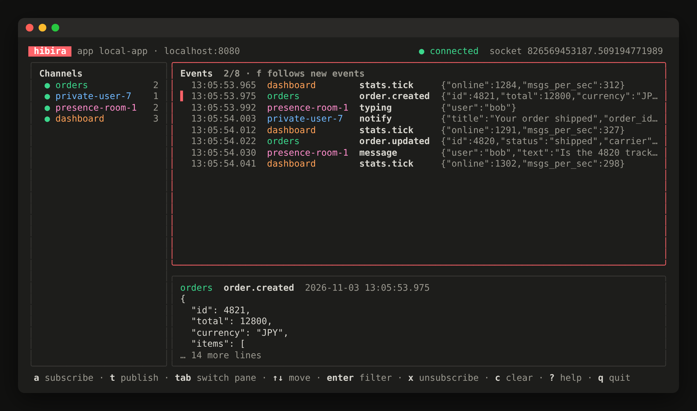

# Hibira CLI

Send and watch realtime events on [Hibira](https://hibira.io) from your terminal. Hibira is a hosted, Pusher-compatible realtime WebSocket service; this tool speaks the same protocol, so it is handy for checking that your backend publishes what you expect and that your channels and auth behave.

```console
$ hibira listen orders
· connected, socket id 235402573869.791008616710
· subscribed to orders
12:49:01.745  orders  order.updated  {"id":42,"status":"shipped"}

$ hibira trigger orders order.updated '{"id":42,"status":"shipped"}'
Sent "order.updated" to orders (28 bytes)
```

Run `hibira` with no arguments in a terminal for the interactive view:



## Install

macOS and Linux (Intel and Apple silicon / ARM):

```sh
curl -fsSL https://hibira.io/install.sh | sh
```

Windows (PowerShell):

```powershell
irm https://hibira.io/install.ps1 | iex
```

The short links redirect to [`install.sh`](install.sh) and [`install.ps1`](install.ps1) in this repository. The scripts download the right archive from the [latest release](https://github.com/hibira-io/cli/releases/latest), check it against `checksums.txt` and install `hibira` to `/usr/local/bin` when that is writable, otherwise `~/.local/bin` (`%LOCALAPPDATA%\Programs\hibira` on Windows, added to your user PATH). Set `HIBIRA_VERSION=v0.1.0` to pin a version or `HIBIRA_INSTALL_DIR` to choose the folder.

With Go 1.26 or later you can also run:

```sh
go install github.com/hibira-io/cli/cmd/hibira@latest
```

Or download an archive yourself from the [releases page](https://github.com/hibira-io/cli/releases).

## Credentials

Copy the app ID, key and secret from your app's page in the [Hibira portal](https://hibira.io/portal). Each value is read from the first place it is set:

1. Flags: `--app-id`, `--key`, `--secret`, `--host`, `--scheme`
2. Environment: `HIBIRA_APP_ID`, `HIBIRA_APP_KEY`, `HIBIRA_APP_SECRET`, `HIBIRA_HOST`, `HIBIRA_PORT`, `HIBIRA_SCHEME` (the same names the Hibira framework packages use, so an existing `.env` works)
3. A saved profile

The host defaults to `ws.hibira.io`. Use the host your app page shows if it differs, such as `ws-edge.hibira.io`.

Save a profile once so you don't have to pass anything:

```sh
hibira config set --app-id 123 --key abc     # asks for the secret without echo
hibira config set --profile staging --app-id 456 --key def
hibira config use staging                    # change the default profile
hibira config show                           # what will be used (secret masked)
```

Profiles live in `hibira/config.json` under your user config folder (`~/.config` on Linux, `~/Library/Application Support` on macOS, `%AppData%` on Windows; `hibira config path` prints it, `HIBIRA_CONFIG` overrides it) and the file is readable by your user only. Prefer the prompt, `--secret-stdin` or the environment over `--secret`, which ends up in your shell history.

## Commands

### `hibira tui [CHANNEL...]` (or just `hibira`)

A full-screen view for poking at an app: your channels on the left with a live count, events streaming in on the right, and the selected event's data pretty-printed below.

| Key | Does |
| --- | --- |
| `a` | subscribe to a channel (private and presence channels are signed locally) |
| `t` | publish an event; the channel is prefilled from the selected one |
| `tab`, `← →` | switch between the channel list and the event stream |
| `↑ ↓`, `PgUp PgDn` | move through channels or events |
| `enter` / `esc` | show only the selected channel's events / show all again |
| `f` | jump to the newest event and keep following |
| `x` | unsubscribe from the selected channel |
| `c` | clear the event list |
| `?`, `q` | all keys, quit |

```sh
hibira tui orders private-user-7 presence-room-1 --user-id alice
```

Publishing from the view needs the app ID and secret; watching only needs the key. In scripts and pipes use `listen` and `trigger` below, which print plain lines.

### `hibira trigger CHANNEL EVENT [DATA]`

Publishes an event through the HTTP API, exactly like your backend would.

```sh
hibira trigger orders order.updated '{"id":42}'
hibira trigger orders order.updated -c dashboard -c audit '{"id":42}'   # several channels
cat payload.json | hibira trigger private-user-7 notify -               # data from stdin
hibira trigger chat message '{"text":"hi"}' --socket-id 1234.5678       # skip one connection
```

Without `DATA` the event carries `{}`. Add `--json` to print the API response.

### `hibira listen CHANNEL [CHANNEL...]`

Connects over WebSocket, subscribes and prints every event until you press Ctrl+C. It reconnects on its own when the connection drops (`--no-reconnect` to exit instead).

```sh
hibira listen orders dashboard
hibira listen private-user-7                                  # signed locally with the app secret
hibira listen presence-room-1 --user-id alice --user-info '{"name":"Alice"}' --internal
hibira listen orders --json | jq .data                        # one JSON object per line
```

Private and presence channels are signed with the app secret on your machine, so you don't need your auth endpoint running. `--internal` also prints protocol events such as `pusher_internal:member_added`. `--pretty` indents JSON data and `-q` hides the status lines. Encrypted channels (`private-encrypted-`) are not supported yet.

### `hibira channels`

Lists channels that have subscribers right now.

```sh
hibira channels
hibira channels --prefix presence- --info user_count
```

### `hibira approvals`

Manages [Hibira Approvals](https://hibira.io/approvals) workspaces: the people who answer your agents' and workflows' approval requests. These commands use a Hibira API token instead of an app's key and secret: make a personal token with read and write access on the portal's [API tokens](https://hibira.io/portal/api-tokens) page and set `HIBIRA_API_TOKEN`. The token acts as its owner's (verified) email.

```console
$ hibira approvals workspaces
ID                    NAME           PLAN  ROLE   WAITING
apw_673c619d0c52a683  Ops approvals  free  admin  0

$ hibira approvals add apw_673c619d0c52a683 dba@example.com --role approver
dba@example.com is now an approver in Ops approvals. They sign in at approvals.hibira.io with that email.

$ hibira approvals test apw_673c619d0c52a683
Sent apr_d702b2cdd68af3f7eb40: Test request: deploy to production
Answer it on your phone or at https://approvals.hibira.io/inbox/apr_d702b2cdd68af3f7eb40
```

Also `create NAME`, `members WORKSPACE`, `remove WORKSPACE EMAIL` and `requests WORKSPACE [--history]`; `--json` prints the API's answer.

### Shell completion

```sh
hibira completion bash|zsh|fish|powershell --help
```

## Development

```sh
go test ./...
go build -o bin/hibira ./cmd/hibira
```

Releases are built by GoReleaser when a `v*` tag is pushed.

## License

MIT

---

## 中文摘要

Hibira CLI 是一個在終端機裡收發即時事件的小工具，用來除錯。直接執行 `hibira` 會開啟互動介面（左邊頻道列表、右邊即時事件流、下方事件 JSON 詳情，按 `a` 訂閱、`t` 發事件）。`hibira trigger` 透過 HTTP API 發佈事件，`hibira listen` 用 WebSocket 訂閱頻道並即時印出事件（private / presence 頻道會用 app secret 在本機簽名，不需要架 auth endpoint），`hibira channels` 列出目前有人訂閱的頻道。`hibira approvals` 用 Hibira API token（環境變數 `HIBIRA_API_TOKEN`）管理 Approvals 工作區：列出工作區、建立、加入或移除成員、傳一筆測試請求給自己。憑證依序從參數、環境變數（`HIBIRA_APP_ID`、`HIBIRA_APP_KEY`、`HIBIRA_APP_SECRET`、`HIBIRA_HOST`）、`hibira config set` 存的設定檔讀取。安裝：macOS / Linux 執行 `curl -fsSL https://hibira.io/install.sh | sh`，Windows 在 PowerShell 執行 `irm https://hibira.io/install.ps1 | iex`；也可以用 `go install github.com/hibira-io/cli/cmd/hibira@latest`。
